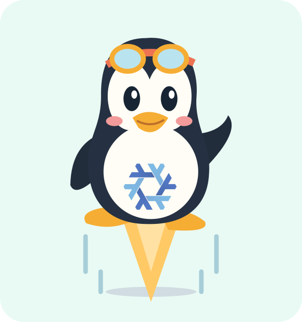
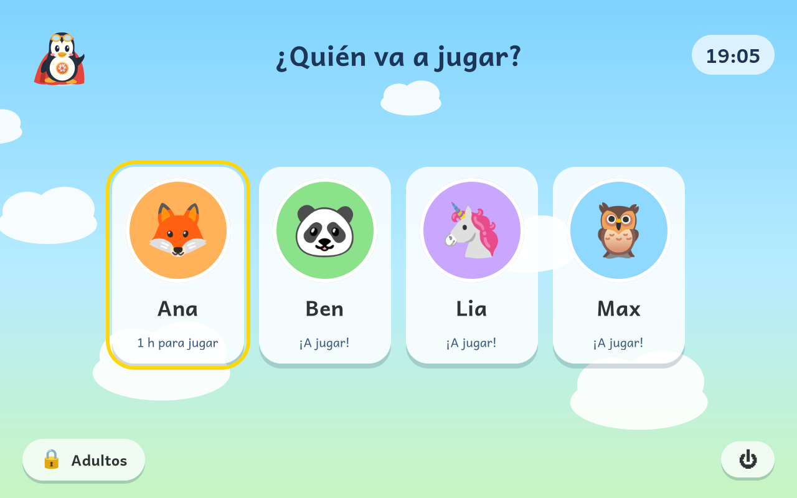
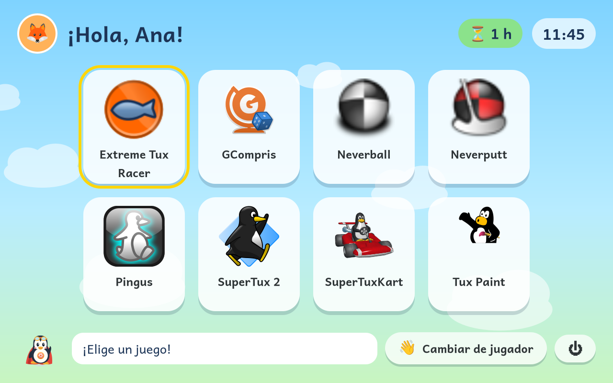
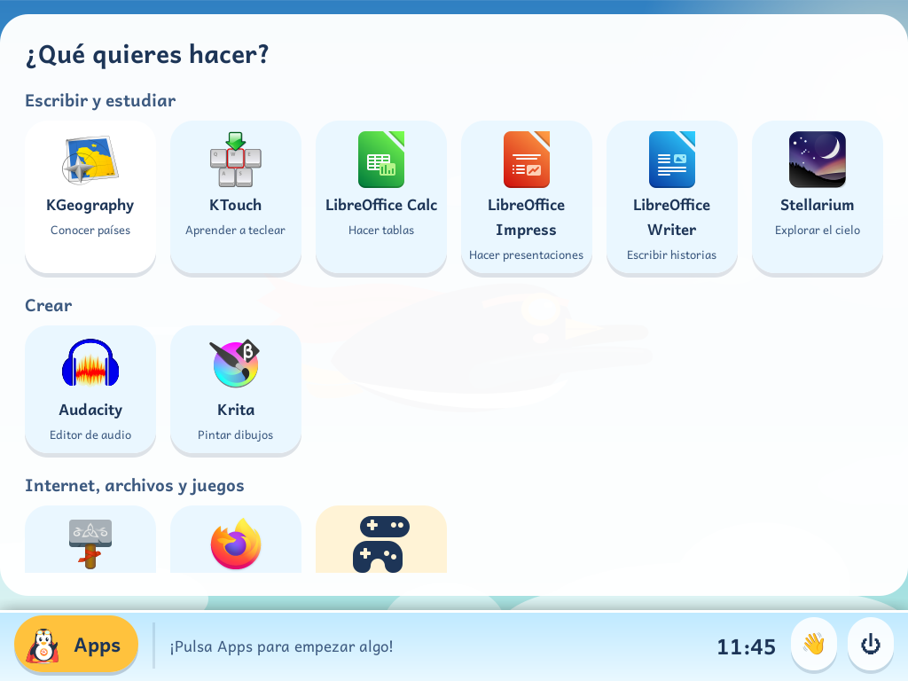
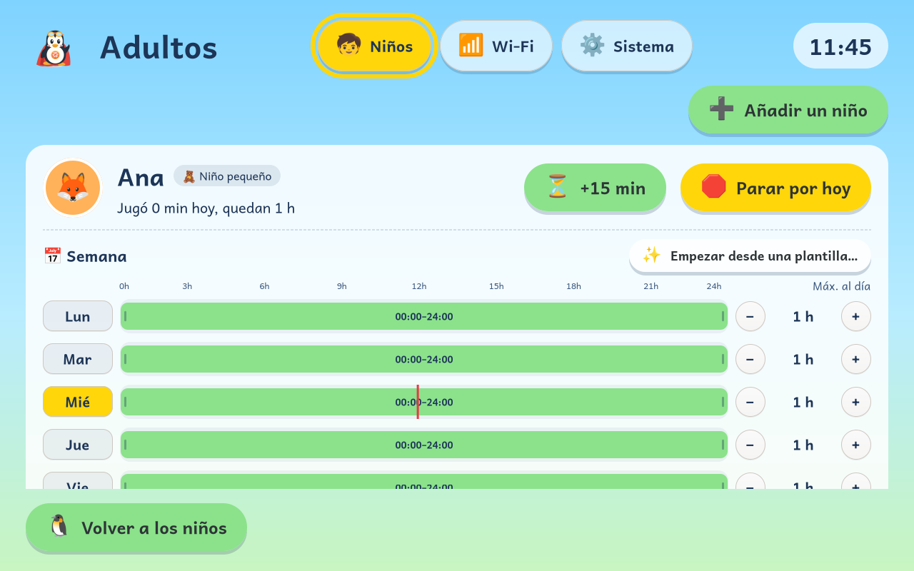

  

  <a href="README.md">English</a> · <a href="README.pt-BR.md">Português (Brasil)</a> · <b>Español</b>

# Zoomies

Zoomies convierte un ordenador en un lugar seguro para que los niños
jueguen y aprendan. Ellos eligen su carita y juegan; tú decides cuándo y
durante cuánto tiempo.

Es gratuito y de código abierto, sin anuncios, sin cuentas y sin
suscripciones. Basta con un PC antiguo o una Raspberry Pi.

Te presentamos a **Zip**, un pollito de pingüino que no para quieto. Zip
acompaña a los niños desde el momento en que se enciende el ordenador.

  

## Lo que reciben los niños

Cada niño tiene una carita en la pantalla «¿Quién va a jugar?». Basta con
elegirla para empezar: no hay contraseñas que recordar. Las partidas
guardadas y el tiempo de juego de cada niño se mantienen separados.

### Niños pequeños: solo los juegos

Una pantalla llena de botones grandes, uno por juego, y nada más en lo que
perderse.

  

- Juegos para correr, saltar, pintar y aprender: SuperTuxKart, SuperTux,
  Extreme Tux Racer, Neverball, Pingus, Tux Paint y GCompris, que por sí
  solo trae más de cien actividades con letras, números y lógica.
- Sin internet, a menos que tú lo abras.
- Nada que romper: salvo las partidas guardadas, el ordenador olvida lo que
  un niño pequeño cambió cada vez que se enciende.

### Niños mayores: un escritorio para estudiar y jugar

Un escritorio sencillo, con sus aplicaciones a un botón de distancia, donde
sus archivos se conservan.

  

- Escribir cuentos, hacer tablas y presentaciones (LibreOffice), pintar
  (Krita), grabar sonidos (Audacity), aprender a escribir con el teclado
  (KTouch), conocer los países (KGeography) y explorar el cielo
  (Stellarium).
- Los mismos juegos que los pequeños.
- Internet, con Firefox, a través de un filtro familiar que mantiene lejos
  los sitios para adultos y los peligrosos.

## Lo que tú decides

Todo está en el panel de los adultos, detrás de un PIN que solo tú conoces.

  

- **La semana.** Para cada niño y cada día: a qué horas puede jugar, y
  cuánto tiempo como máximo. Empieza con una semana ya hecha, como «Semana
  de clases» o «Solo fines de semana», y cambia el día que quieras.
- **Días especiales.** Un festivo o un viaje puede contar como un sábado, o
  como un día sin juego.
- **Ahora mismo.** Da 15 minutos más, o para por hoy.
- **Internet.** Para cada niño: apagado, encendido algunos días de la
  semana, o abierto durante 30 minutos, una hora o el resto del día.
- **Pantalla tranquila.** Detiene las nubes y los vuelos de Zip, para los
  niños a los que el movimiento distrae.
- **Niños.** Añádelos, cámbiales el nombre o quítalos, y elige quién es
  pequeño y quién es mayor.

Cuando el tiempo está por acabarse, Zoomies avisa al niño cinco minutos y
un minuto antes, luego cierra el juego y le dice cuándo puede volver. No
tienes que ser tú quien diga «se acabó el tiempo».

## Lo que Zoomies no hace

- **Las caritas no son contraseñas.** Nada impide que un niño elija la
  carita de otro y use su tiempo.
- **El filtro de internet no es un candado.** Mantiene los sitios para
  adultos y los peligrosos fuera de la navegación de cada día, pero no
  sustituye que estés cerca.
- **No vigila a los niños.** Zoomies cuenta el tiempo de juego, pero no
  registra lo que hacen ni se lo cuenta a nadie.

## Lo que necesitas

| | PC | Raspberry Pi |
|---|---|---|
| Ordenador | Un PC de 64 bits, como la mayoría de los fabricados desde 2010 | Raspberry Pi 3, 4 o 5 |
| Memoria | 2 GB o más | 1 GB para niños pequeños, 2 GB para los mayores |
| Almacenamiento | Un disco de 20 GB o más | Una tarjeta SD de 16 GB o más |
| Para instalar | Una memoria USB de 8 GB o más | Nada más |

SuperTuxKart necesita una Raspberry Pi 4 o 5.

## Instálalo en un PC

> [!WARNING]
> Instalar Zoomies borra el disco en el que se instala. Antes, guarda lo
> que quieras conservar.

1. Descarga `zoomies-installer-<versión>.iso` de la
   [última versión](https://github.com/OSSystems/zoomies/releases/latest).
2. Grábalo en una memoria USB con [balenaEtcher](https://etcher.balena.io/):
   elige el archivo, elige la memoria y pulsa Flash. Esto borra la memoria.
3. Conecta la memoria al PC y enciéndelo. Si el PC arranca como siempre, en
   lugar de mostrar a Zip, enciéndelo de nuevo pulsando la tecla que abre
   el menú de arranque; suele ser F12, F9, Esc o Supr.
4. Sigue el instalador: pregunta tu idioma, tu zona horaria, tu teclado y
   el disco que usar.
5. Cuando termine, retira la memoria y reinicia.

No hace falta internet para instalar: todo está en la memoria USB.

## Instálalo en una Raspberry Pi

1. Descarga `zoomies-raspberry-pi-<versión>.img.zst` de la
   [última versión](https://github.com/OSSystems/zoomies/releases/latest).
2. Grábalo en la tarjeta SD con
   [Raspberry Pi Imager](https://www.raspberrypi.com/software/): en
   «Choose OS», elige «Use custom» y el archivo que descargaste. Esto borra
   la tarjeta.
3. Pon la tarjeta en la Pi y enciéndela.

## La primera vez que arranca

Zoomies pregunta tres cosas, y ya está listo:

1. **Wi-Fi.** Elige tu red, o sáltalo y hazlo después.
2. **Un PIN** de 4 a 12 dígitos, para el panel de los adultos. Los niños no
   deben verlo.
3. **Quién va a jugar.** Escribe el nombre de cada niño y elige una carita.

## En el día a día

Para abrir el panel de los adultos, mantén pulsado el 🔒 en la pantalla
«¿Quién va a jugar?», o pulsa Ctrl+Alt+P, y escribe tu PIN. Tras cinco PIN
incorrectos, el panel queda bloqueado durante diez minutos.

Desde ahí también puedes conectarte a otra Wi-Fi, cambiar el PIN y
reiniciar o apagar el ordenador.

## Actualizaciones

Zoomies se mantiene al día por sí solo cuando tiene internet. Descarga en
segundo plano mientras los niños juegan, y la versión nueva empieza la
próxima vez que se encienda el ordenador, nunca en mitad de un juego. Los
niños y sus reglas se conservan.

## Preguntas e ideas

¿Algo no funciona, o tienes una idea para mejorar Zoomies?
[Cuéntanos](https://github.com/OSSystems/zoomies/issues).

## Para desarrolladores

Zoomies está hecho con NixOS. [DEVELOPMENT.md](DEVELOPMENT.md), en inglés,
explica cómo probarlo en una máquina virtual, generar las imágenes, usarlo
en tu propia configuración de NixOS y orientarte en el código.

## Licencia

Zoomies es de código abierto, bajo la [licencia MIT](LICENSE). Los juegos y
aplicaciones que trae tienen sus propias licencias de código abierto.
