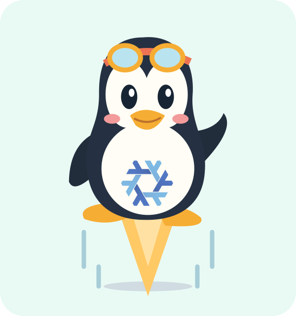
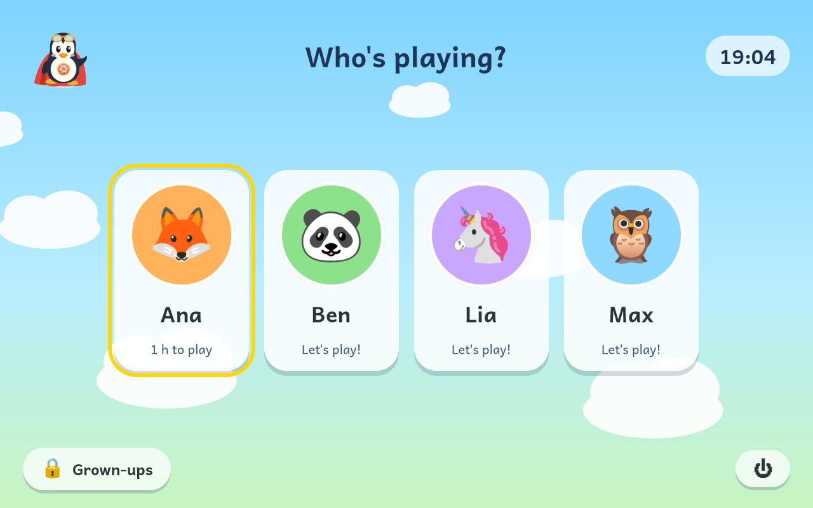
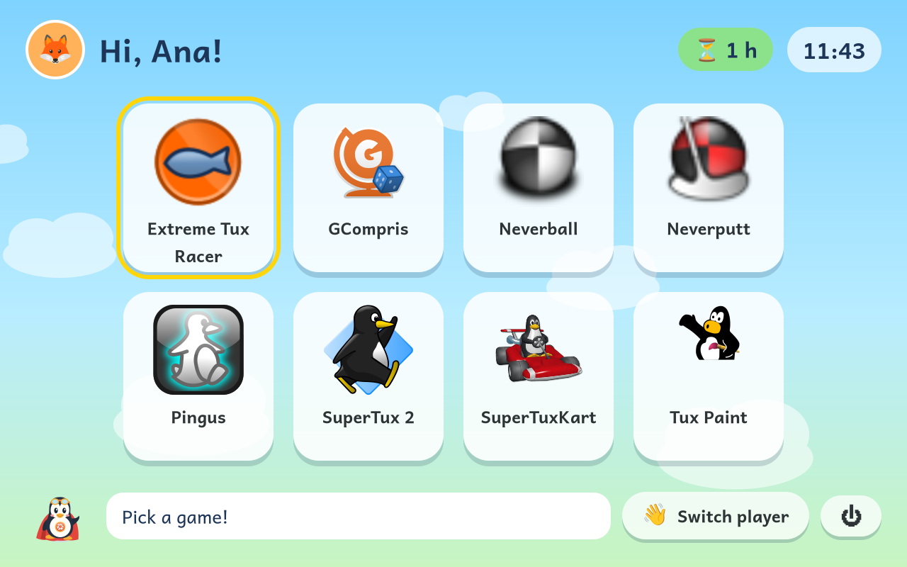
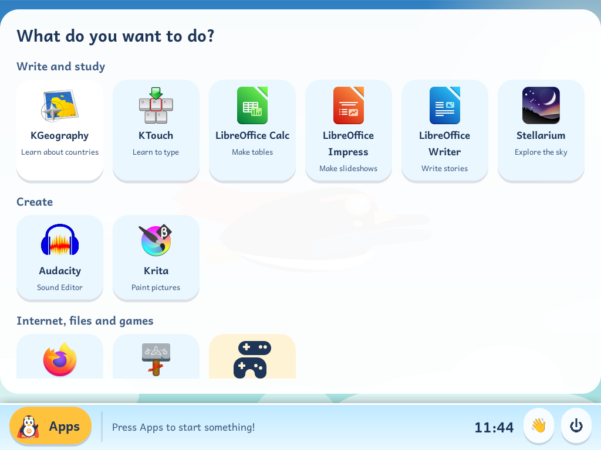
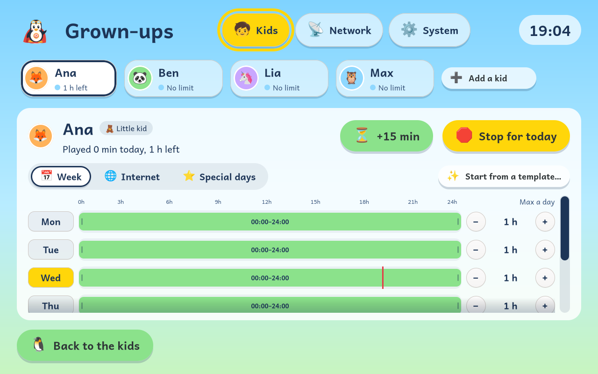

  

  <b>English</b> · <a href="README.pt-BR.md">Português (Brasil)</a> · <a href="README.es.md">Español</a>

# Zoomies

Zoomies turns a computer into a safe place for kids to play and learn. They
pick their face and play; you decide when and for how long.

It is free and open source, with no ads, no accounts and no subscriptions.
An old PC or a Raspberry Pi is enough.

Meet **Zip**, a penguin chick with a permanent case of the zoomies. Zip
keeps your kids company from the moment the computer turns on.

  

## What your kids get

Each kid has a face on the "Who's playing?" screen. Picking it is all it
takes to start: no passwords to remember. Saved games and play time are kept
apart for each kid.

### Little kids: just the games

A screen full of big tiles, one per game, and nothing else to get lost in.

  

- Games to race, jump, paint and learn: SuperTuxKart, SuperTux, Extreme Tux
  Racer, Neverball, Pingus, Tux Paint and GCompris, which alone brings more
  than a hundred activities for letters, numbers and logic.
- No internet, unless you open it for them.
- Nothing to break: apart from saved games, the computer forgets what a
  little kid changed each time it starts.

### Older kids: a desktop for study and play

A simple desktop, with their apps one button away, where their files are
kept.

  

- Write stories, make tables and slideshows (LibreOffice), paint (Krita),
  record sounds (Audacity), learn to type (KTouch), learn about countries
  (KGeography) and explore the sky (Stellarium).
- The same games as the little ones.
- The web, with Firefox, through a family filter that keeps adult and
  dangerous sites away.

## What you decide

Everything is in the grown-ups panel, behind a PIN only you know.

  

- **The week.** For each kid and each day: at what times they may play, and
  for how long at most. Start from a ready-made week, such as "School week"
  or "Weekends only", and change any day.
- **Special days.** A holiday or a trip can play like a Saturday, or not at
  all.
- **Right now.** Give 15 minutes more, or stop for today.
- **Internet.** For each kid: off, on for some days of the week, or open
  for 30 minutes, an hour or the rest of today.
- **Calm screen.** Stops the clouds and Zip's flying, for kids who find
  movement distracting.
- **Kids.** Add, rename or remove them, and choose who is a little kid and
  who is an older one.

When time is almost up, Zoomies warns the kid five minutes and one minute
ahead, then closes the game and says when they can come back. You don't have to be the
one who says "time's up".

## What Zoomies does not do

- **Faces are not passwords.** Nothing stops one kid from picking another's
  face and using their play time.
- **The web filter is not a lock.** It keeps adult and dangerous sites out
  of everyday browsing, but it does not replace you being around.
- **It does not watch your kids.** Zoomies counts play time, but it does
  not record what they do or report it to anyone.

## What you need

| | PC | Raspberry Pi |
|---|---|---|
| Computer | A 64-bit PC, like most made since 2010 | Raspberry Pi 3, 4 or 5 |
| Memory | 2 GB or more | 1 GB for little kids, 2 GB for older kids |
| Storage | A disk of 20 GB or more | An SD card of 16 GB or more |
| To install | A USB stick of 8 GB or more | Nothing else |

SuperTuxKart needs a Raspberry Pi 4 or 5.

## Install it on a PC

> [!WARNING]
> Installing Zoomies erases the disk you install it on. Save anything you
> want to keep first.

1. Download `zoomies-installer.iso` from the
   [latest release](https://github.com/OSSystems/zoomies/releases/latest).
2. Write it to a USB stick with [balenaEtcher](https://etcher.balena.io/):
   pick the file, pick the stick, press Flash. This erases the stick.
3. Plug the stick into the PC and turn it on. If the PC starts as usual
   instead of showing Zip, turn it on again while pressing the key that
   opens its boot menu; it is often F12, F9, Esc or Del.
4. Follow the installer: it asks for your language, your time zone, your
   keyboard and the disk to use.
5. When it finishes, take the stick out and restart.

No internet is needed to install: everything is on the stick.

## Install it on a Raspberry Pi

1. Download `zoomies-raspberry-pi.img.zst` from the
   [latest release](https://github.com/OSSystems/zoomies/releases/latest).
2. Write it to the SD card with
   [Raspberry Pi Imager](https://www.raspberrypi.com/software/): under
   "Choose OS" pick "Use custom" and the file you downloaded. This erases
   the card.
3. Put the card in the Pi and turn it on.

## The first time it starts

Zoomies asks three things, and then it is ready:

1. **Wi-Fi.** Pick your network, or skip it and do it later.
2. **A PIN** of 4 to 12 digits, for the grown-ups panel. Kids should not
   see it.
3. **Who will play.** Type each kid's name and pick a face.

## Every day

To open the grown-ups panel, press and hold 🔒 on the "Who's playing?"
screen, or press Ctrl+Alt+P, and type your PIN. After five wrong PINs the
panel stays locked for ten minutes.

From there you can also connect to another Wi-Fi, change the PIN, and
restart or turn off the computer.

## Updates

Zoomies keeps itself up to date when it has internet. It downloads in the
background while the kids play, and the new version starts the next time
the computer is turned on, never in the middle of a game. Your kids and
their rules are kept.

## Questions and ideas

Something not working, or an idea to make Zoomies better?
[Tell us](https://github.com/OSSystems/zoomies/issues).

## For developers

Zoomies is built on NixOS. [DEVELOPMENT.md](DEVELOPMENT.md) explains how to
try it in a virtual machine, build the images, use it in your own NixOS
configuration and find your way around the code.

## License

Zoomies is open source, under the [MIT license](LICENSE). The games and
apps it brings have their own open-source licenses.
