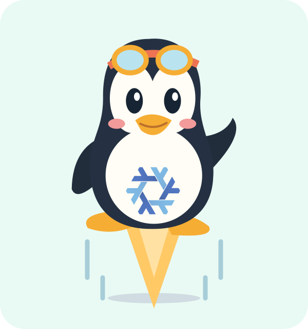
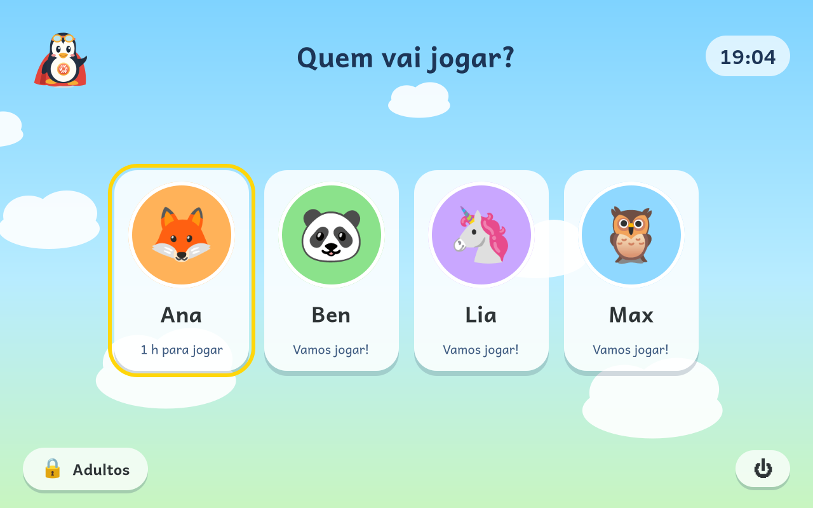
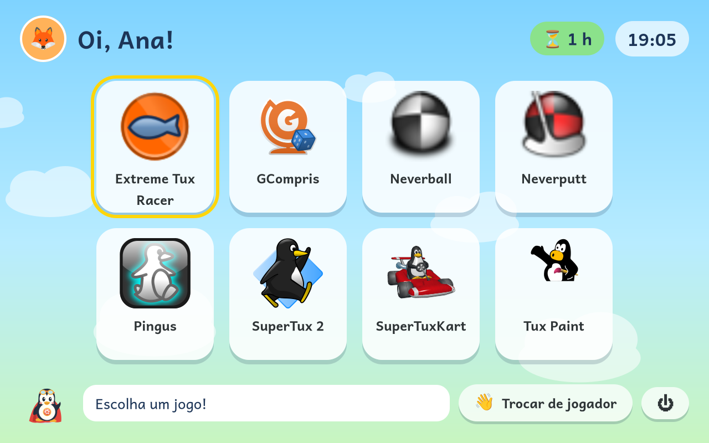
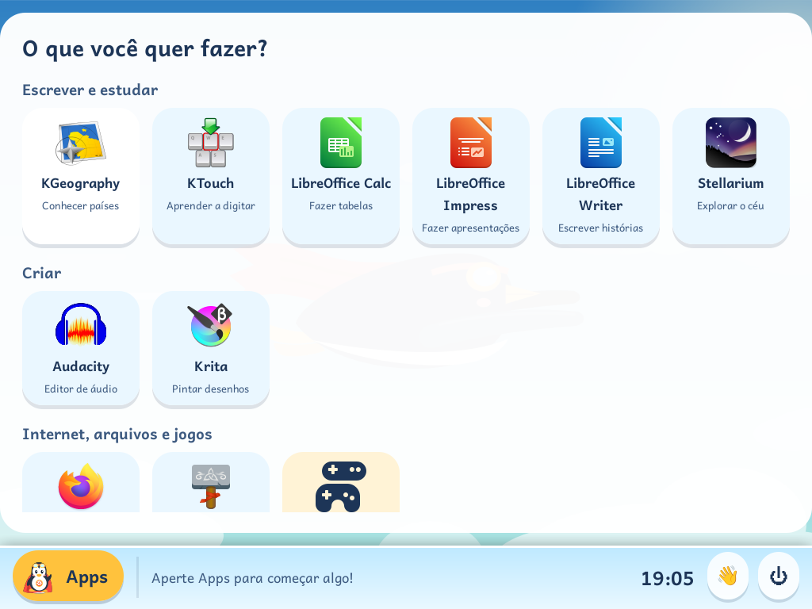
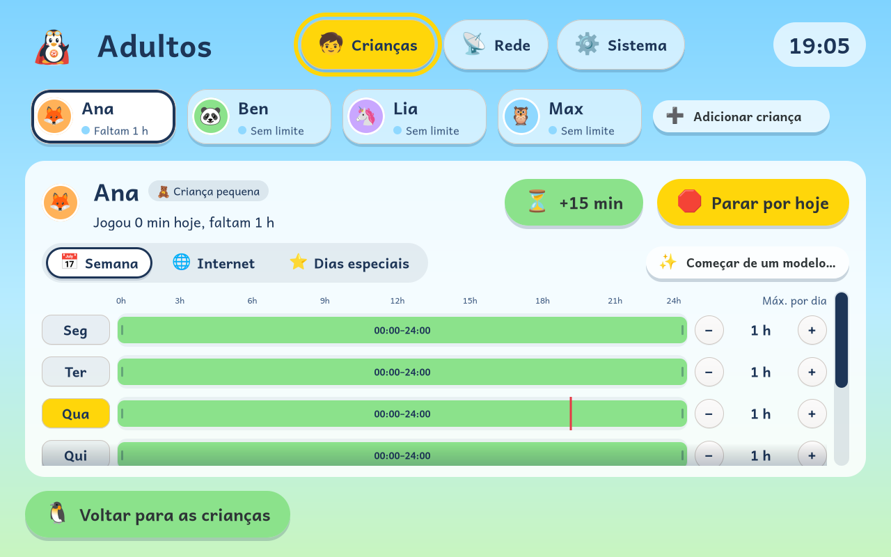

  

  <a href="README.md">English</a> · <b>Português (Brasil)</b> · <a href="README.es.md">Español</a>

# Zoomies

O Zoomies transforma um computador em um lugar seguro para as crianças
brincarem e aprenderem. Elas escolhem o seu rostinho e jogam; você decide
quando e por quanto tempo.

É gratuito e de código aberto, sem anúncios, sem contas e sem assinaturas.
Um PC antigo ou um Raspberry Pi já basta.

Conheça o **Zip**, um filhote de pinguim que não para quieto. Ele faz
companhia às crianças desde o momento em que o computador liga.

  

## O que as crianças ganham

Cada criança tem um rostinho na tela "Quem vai jogar?". Basta escolhê-lo
para começar: não há senhas para lembrar. Os jogos salvos e o tempo de jogo
de cada criança ficam separados.

### Crianças pequenas: só os jogos

Uma tela cheia de botões grandes, um para cada jogo, e mais nada em que se
perder.

  

- Jogos para correr, pular, pintar e aprender: SuperTuxKart, SuperTux,
  Extreme Tux Racer, Neverball, Pingus, Tux Paint e GCompris, que sozinho
  traz mais de cem atividades com letras, números e lógica.
- Sem internet, a não ser que você a libere.
- Nada para quebrar: fora os jogos salvos, o computador esquece o que uma
  criança pequena mudou cada vez que é ligado.

### Crianças maiores: uma área de trabalho para estudar e brincar

Uma área de trabalho simples, com os aplicativos a um botão de distância,
onde os arquivos delas ficam guardados.

  

- Escrever histórias, fazer tabelas e apresentações (LibreOffice), pintar
  (Krita), gravar sons (Audacity), aprender a digitar (KTouch), conhecer os
  países (KGeography) e explorar o céu (Stellarium).
- Os mesmos jogos das crianças pequenas.
- A internet, com o Firefox, por um filtro familiar que mantém longe os
  sites adultos e perigosos.

## O que você decide

Tudo fica no painel dos adultos, atrás de um PIN que só você conhece.

  

- **A semana.** Para cada criança e cada dia: em que horários ela pode
  jogar, e por quanto tempo no máximo. Comece por uma semana pronta, como
  "Semana de aula" ou "Só fins de semana", e mude o dia que quiser.
- **Dias especiais.** Um feriado ou uma viagem pode valer como um sábado,
  ou como um dia sem jogo.
- **Agora mesmo.** Dê mais 15 minutos, ou pare por hoje.
- **Internet.** Para cada criança: desligada, ligada em alguns dias da
  semana, ou aberta por 30 minutos, uma hora ou o resto do dia.
- **Tela calma.** Para as nuvens e os voos do Zip, para crianças que se
  distraem com movimento.
- **Crianças.** Adicione, renomeie ou remova, e escolha quem é pequena e
  quem é maior.

Quando o tempo está acabando, o Zoomies avisa a criança cinco minutos e um
minuto antes, depois fecha o jogo e diz quando ela pode voltar. Não precisa
ser você a dizer "acabou o tempo".

## O que o Zoomies não faz

- **Rostinhos não são senhas.** Nada impede uma criança de escolher o
  rostinho de outra e usar o tempo dela.
- **O filtro da internet não é uma tranca.** Ele mantém os sites adultos e
  perigosos fora da navegação do dia a dia, mas não substitui você por
  perto.
- **Ele não vigia as crianças.** O Zoomies conta o tempo de jogo, mas não
  registra o que elas fazem nem conta a ninguém.

## Do que você precisa

| | PC | Raspberry Pi |
|---|---|---|
| Computador | Um PC de 64 bits, como a maioria dos fabricados desde 2010 | Raspberry Pi 3, 4 ou 5 |
| Memória | 2 GB ou mais | 1 GB para crianças pequenas, 2 GB para as maiores |
| Armazenamento | Um disco de 20 GB ou mais | Um cartão SD de 16 GB ou mais |
| Para instalar | Um pendrive de 8 GB ou mais | Mais nada |

O SuperTuxKart precisa de um Raspberry Pi 4 ou 5.

## Instale em um PC

> [!WARNING]
> Instalar o Zoomies apaga o disco em que ele é instalado. Antes, guarde o
> que você quiser manter.

1. Baixe o `zoomies-installer-<versão>.iso` da
   [última versão](https://github.com/OSSystems/zoomies/releases/latest).
2. Grave-o em um pendrive com o [balenaEtcher](https://etcher.balena.io/):
   escolha o arquivo, escolha o pendrive e clique em Flash. Isso apaga o
   pendrive.
3. Conecte o pendrive ao PC e ligue-o. Se o PC iniciar como de costume, em
   vez de mostrar o Zip, ligue-o de novo pressionando a tecla que abre o
   menu de inicialização; costuma ser F12, F9, Esc ou Del.
4. Siga o instalador: ele pergunta o seu idioma, o seu fuso horário, o seu
   teclado e o disco a usar.
5. Quando terminar, retire o pendrive e reinicie.

Não é preciso internet para instalar: está tudo no pendrive.

## Instale em um Raspberry Pi

1. Baixe o `zoomies-raspberry-pi-<versão>.img.zst` da
   [última versão](https://github.com/OSSystems/zoomies/releases/latest).
2. Grave-o no cartão SD com o
   [Raspberry Pi Imager](https://www.raspberrypi.com/software/): em
   "Choose OS", escolha "Use custom" e o arquivo que você baixou. Isso apaga
   o cartão.
3. Coloque o cartão no Pi e ligue-o.

## Na primeira vez que ele liga

O Zoomies pergunta três coisas, e pronto:

1. **Wi-Fi.** Escolha a sua rede, ou pule e faça isso depois.
2. **Um PIN** de 4 a 12 dígitos, para o painel dos adultos. As crianças não
   devem vê-lo.
3. **Quem vai jogar.** Digite o nome de cada criança e escolha um rostinho.

## No dia a dia

Para abrir o painel dos adultos, mantenha pressionado o 🔒 na tela "Quem
vai jogar?", ou pressione Ctrl+Alt+P, e digite o seu PIN. Depois de cinco
PINs errados, o painel fica bloqueado por dez minutos.

Dali você também pode conectar a outro Wi-Fi, dar ao computador um
endereço fixo no cabo ou no Wi-Fi, trocar o PIN e reiniciar ou desligar o
computador.

## Atualizações

O Zoomies se mantém atualizado sozinho quando tem internet. Ele baixa em
segundo plano enquanto as crianças jogam, e a versão nova começa na próxima
vez que o computador for ligado, nunca no meio de um jogo. As crianças e as
regras delas são mantidas.

## Dúvidas e ideias

Algo não funciona, ou você tem uma ideia para melhorar o Zoomies?
[Conte para nós](https://github.com/OSSystems/zoomies/issues).

## Para desenvolvedores

O Zoomies é feito com NixOS. O [DEVELOPMENT.md](DEVELOPMENT.md), em inglês,
explica como experimentá-lo em uma máquina virtual, gerar as imagens, usá-lo
na sua própria configuração do NixOS e se localizar no código.

## Licença

O Zoomies é de código aberto, sob a [licença MIT](LICENSE). Os jogos e
aplicativos que ele traz têm as suas próprias licenças de código aberto.
